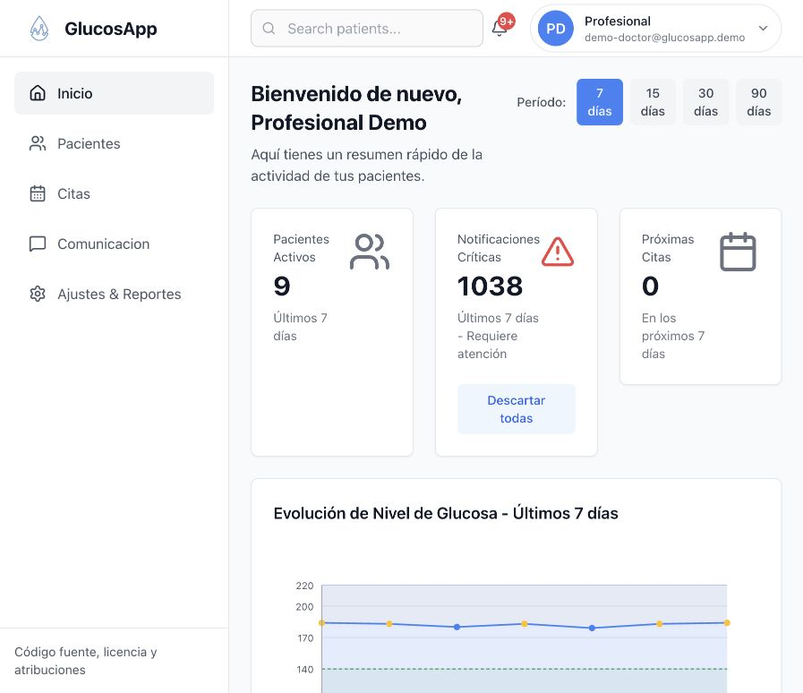
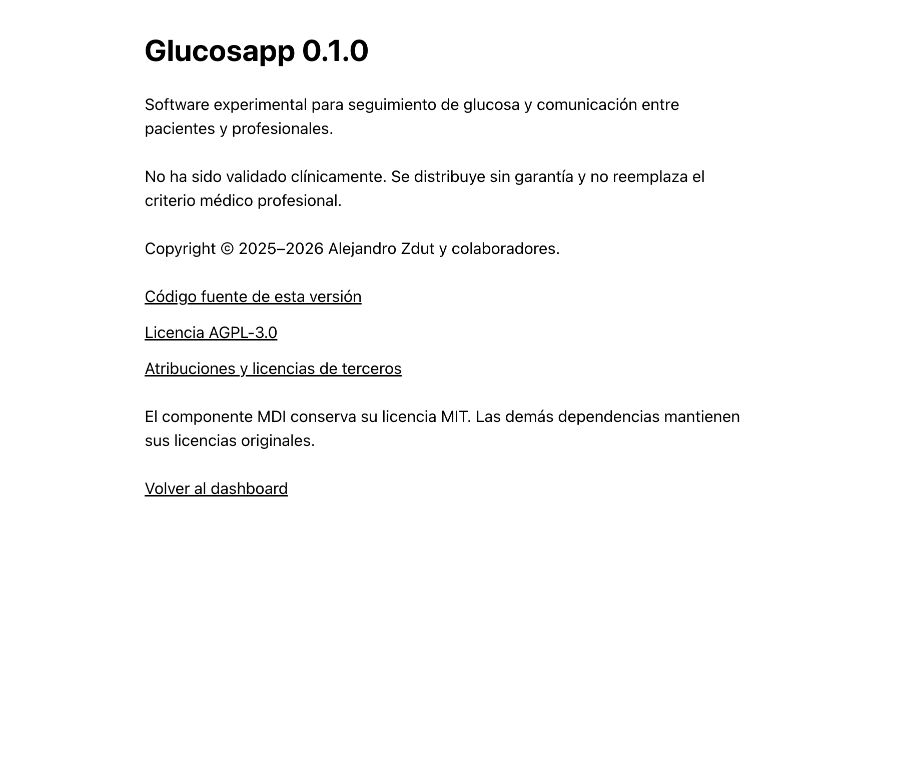

# Glucosapp

[](https://github.com/alezdut/glucosapp/actions/workflows/ci.yml)
[](LICENSE)

Plataforma open source experimental para seguimiento de glucosa y comunicación entre pacientes y profesionales. API NestJS/Prisma/PostgreSQL, web Next.js y móvil Expo/React Native, con tipos, utilidades y algoritmo MDI compartidos.

**No validada clínicamente. Sin garantía.** Los cálculos no reemplazan el criterio médico. La demo usa exclusivamente datos sintéticos y debe permanecer local.

## Probar v0.1.0

Requisitos: Node 20.19.5, pnpm 9.12.2 y Docker con Compose v2. PostgreSQL local también es compatible: vea [SETUP](docs/SETUP.md).

```sh
git clone https://github.com/alezdut/glucosapp.git
cd glucosapp
git checkout v0.1.0
corepack enable
corepack prepare pnpm@9.12.2 --activate
pnpm install --frozen-lockfile
pnpm demo:setup
pnpm dev
```

Abra web en http://localhost:3001 y Swagger en http://localhost:3000/docs. En otra terminal ejecute `pnpm dev:mobile` para abrir móvil en un entorno Expo compatible.

| Cuenta ficticia | Email                                                              | Contraseña local |
| --------------- | ------------------------------------------------------------------ | ---------------- |
| Profesional     | demo-doctor@glucosapp.demo                                         | Demo123!         |
| Paciente        | demo-patient-1@glucosapp.demo                                      | Demo123!         |
| Otros pacientes | demo-patient-2@glucosapp.demo hasta demo-patient-10@glucosapp.demo | Demo123!         |

`pnpm demo:setup` crea una base dedicada `glucosapp_demo`, genera secretos locales y prepara un profesional con diez pacientes asociados. Repetirlo conserva la configuración y evita duplicaciones. No apunta a instalaciones anteriores ni elimina sus bases.

## Capturas de la demo





## Documentación y colaboración

- [Instalación y servicios opcionales](docs/SETUP.md)
- [Guion de demo](docs/DEMO_SCRIPT.md)
- [Arquitectura](docs/ARCHITECTURE.md)
- [Contribuir y verificar cambios](CONTRIBUTING.md)
- [Reportar vulnerabilidades de forma privada](SECURITY.md)
- [Cambios y limitaciones de v0.1.0](CHANGELOG.md)
- [Licencias y atribuciones](THIRD_PARTY_NOTICES.md)

## Licencia

Copyright © 2025–2026 Alejandro Zdut y colaboradores. Código original bajo [AGPL-3.0-only](LICENSE). El componente MDI conserva MIT y los avisos de OpenAPS; las dependencias y recursos de terceros mantienen sus licencias. Consulte [THIRD_PARTY_NOTICES](THIRD_PARTY_NOTICES.md).
